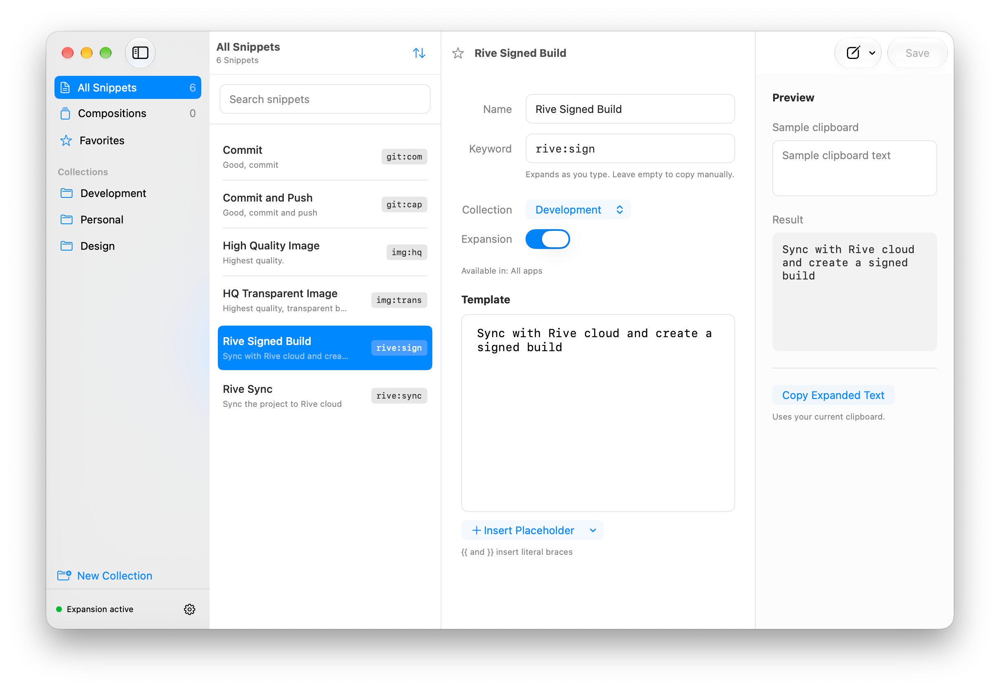

# Textend

[Website, downloads, and documentation](https://usetextend.com/)

A native macOS snippet manager and text expander built with SwiftUI, AppKit, and SwiftData. Requires macOS 14 or later and Xcode 27 to build the layered app icon.



Source code is available under the [MIT license](LICENSE). The Textend name and
artwork are reserved; see [TRADEMARK.md](TRADEMARK.md). Sparkle's license and
third-party notices are included in [Sparkle-LICENSE.txt](Textend/Resources/Sparkle-LICENSE.txt).
KeyboardShortcuts is included under its [MIT license](Textend/Resources/KeyboardShortcuts-LICENSE.txt).
External code contributions are currently closed and pull requests are disabled.
[Bug reports and feature requests](https://github.com/eastechs/textend/issues) are
welcome. See [CONTRIBUTING.md](CONTRIBUTING.md).

## Run

Open `Textend.xcodeproj`, select the Textend scheme, and run, or use:

```sh
./script/build_and_run.sh
```

The Codex Run action uses the same script. It supports `--build-only`, `--verify`, `--debug`, `--logs`, and `--telemetry`.

Debug builds run as **Textend Dev** (`chat.eastechs.textend.debug`), with their own
settings, local library, and Accessibility permission. Production Textend retains
its existing identity and data. The development app is built at
`build/Build/Products/Debug/Textend Dev.app`.

The checked-in project and scripts use Eastechs' CloudKit configuration. They
require a matching Apple Development certificate and development profile, with
no ad hoc fallback. For initial setup, sign in to Xcode Settings → Accounts and
run `./script/build_and_run.sh --setup-development-signing`. See
[iCloud provisioning](docs/icloud-sync.md) for profile renewal and two-Mac testing.
Local development signing does not produce a notarized release.

For an independent build, configure your own Apple Developer team, bundle ID,
CloudKit container, and provisioning profiles in Xcode. Update the corresponding
identifiers in `Config/CloudKit.entitlements`,
`Textend/Core/BuildIdentity.swift`, `Textend/Services/SyncConfiguration.swift`, and
`script/provisioning.py` if using
the scripts. Distributed forks also need their own branding, release configuration
in `script/release.py`, and Sparkle update feed/key in `Config/Updates.xcconfig`;
do not ship a fork pointing to Textend's
official updates. The tests below can run without Eastechs' signing credentials.

## Snippets

Create a snippet with a name, template, and optional keyword. Insert Clipboard or Date & Time placeholders from the editor menu, or type a placeholder such as `{commit_message}` and select its source below the editor. Use `{{` and `}}` for literal braces.

Save before trying a keyword. Templates insert literal text; Textend never executes commands or sends Return to submit them. Copy Expanded Text resolves a draft using the current clipboard, while the preview uses the editable sample clipboard value.

On first launch, Textend explains why it needs Accessibility permission and opens the corresponding system settings. Turn on Textend there, return to the setup guide, and choose Enable Expansion. Permission status updates automatically. Choose Set Up Later to manage and copy snippets without granting access; reopen the guide from Settings → Permissions → Set Up Expansion. Accessibility covers both keyboard monitoring and insertion for Textend's active event tap; a separate Input Monitoring grant is not needed. The menu bar can pause or resume expansion, and closing the library window keeps Textend running. Launch at login is optional.

Enable the separate **Textend Dev** entry in Accessibility once when testing a
development build. Keep the installed **Textend** entry enabled for production.
The build script retains the same development bundle identity and signing
certificate requirements across rebuilds; switching between development and
production no longer replaces a shared permission entry.

For overlapping keywords such as `gc` and `gco`, Textend waits 250 ms after an ambiguous exact match. Tune this under Settings → General → Expansion, from 100 to 1,000 ms. Unambiguous matches expand immediately. Continuing into an incomplete or unrelated keyword cancels the pending shorter match and retains typed text.

Protected input and composition input methods are excluded. Keyword detection follows physical typing within the active application and window, even when an editor omits or recreates its Accessibility elements. Clicks, navigation, shortcuts, and app/window changes cancel pending matches. In fields without readable context, matching starts with a fresh typing run; Textend cannot inspect the preceding word or detect an unreported programmatic field change in those fields. Cursor markers use relative keyboard navigation for up to 256 trailing characters, with native Accessibility positioning for longer moves. The Settings test field uses the same expansion path while the snippet editor stays excluded.

Use Settings → Backups to import or export a versioned JSON backup, including when the Dock icon is hidden. These actions are also available in the File menu. Import adds a validated backup atomically and rejects conflicting identifiers or exact duplicate keywords. Deleting a collection retains its snippets.

Settings → Appearance offers System, Light, and Dark modes, plus an accent color selector. Blue, Purple, Pink, Red, Orange, Yellow, Green, and Graphite use Apple's adaptive system colors. Choices update immediately and persist across launches, including selections in the library and Help. Window controls and system menus continue to use the macOS accent color.

The running app’s Dock icon follows the selected accent using matching versions of the original artwork. Finder and Spotlight retain the installed blue icon, and the menu-bar mark remains monochrome. Menu-bar-only mode keeps the Dock icon hidden.

Help → Textend Help opens a searchable offline guide covering setup, keywords and timing, placeholders, collections, appearance, backups and updates, troubleshooting, and keyboard shortcuts. Press ⌘F in the Help window to search.

## Tests

```sh
swift test
```

Run `./script/check.sh` for formatting checks, tests, and an Xcode build in one command.

Tests cover matching and debounce, template resolution, persistence/imports, unsaved drafts, focus cancellation, and clipboard preservation. Insertion tests capture generated events without posting them to the computer. Cross-app acceptance still requires real typing in target applications.

The selected [design](docs/design/textend-native-macos.png) and [implementation plan](docs/implementation-plan.md) are included in `docs/`.

## App icon and identity

Run `./script/export_icon.sh` to regenerate the 1024-pixel PNG using Icon Composer’s renderer.

Run `python3 script/export_theme_icons.py` to regenerate all eight theme images in the asset catalog. It uses the same Icon Composer source and changes only the background gradient. Runtime Dock rendering adds the standard macOS icon margins; selecting Blue restores the installed layered icon.

The X2 Continuous icon is an editable Icon Composer document at `Textend/Resources/Textend.icon`. Its two SVG ribbon layers are also in `docs/design/textend/`. Xcode compiles the layered icon and the macOS compatibility icon into Textend.app.

The project, scheme, Swift module, and source directory are named Textend. The
released bundle ID `chat.eastechs.tapster`, iCloud container
`iCloud.chat.eastechs.tapster`, and existing storage/window-preference keys remain
stable for update, permission, and saved-library compatibility. These identifiers
are not displayed as the app's name.

## Automatic updates and releases

Textend uses Sparkle for directly distributed releases. The app menu and menu bar offer Check for Updates, and Settings → Updates controls automatic checking and installation. Updates are disabled in Debug builds.

See [local releases](docs/releases.md) for the local build, Developer ID signing, notarization, and DigitalOcean Spaces upload commands. The update feed is `https://cdn.usetextend.com/macos/appcast.xml`. No CI service is required.
